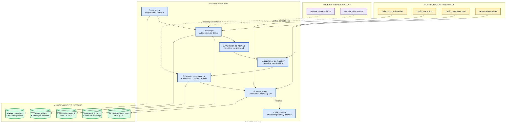

# Arquitectura y flujo

## Vista por módulos



> El SVG es el formato destinado a lectura. La fuente Mermaid, el editable Drawio y el SVG publicado deben mantenerse sincronizados cuando se actualice la arquitectura.

| Módulo | Responsabilidad | Entrada | Salida / estado |
|---|---|---|---|
| `descarga/` | Consultar S3, seleccionar y descargar archivos ABI de GOES-16 o GOES-19 | `setup.json`, S3/NOAA | `data/<intervalo>/*.nc`, `download_db.json`, logs |
| `Procesador/src/resampleo_alg_band.py` | Coordinar validación, remuestreo, conversión y RGB | seis NetCDF de banda | NetCDF RGB por intervalo |
| `Procesador/src/helpers_resampleo.py` | Implementar operaciones numéricas y persistencia NetCDF | radiancia, calibración y configuración | matrices físicas/normalizadas |
| `Procesador/src/mapa_rgb.py` | Recortar, cartografiar y animar | NetCDF RGB, grillas, logo, shapefiles | PNG y GIF |
| `Procesador/diagnostico/` | Analizar B13 y continuidad temporal RGB | bandas B13 o PNG | PNG/JSON/CSV diagnósticos |
| `run_all.py` | Coordinar descarga y procesamiento recuperable | configuraciones y carpetas | productos y `pipeline_state.json` |
| `test/` | Pruebas unitarias de configuración y funciones | fixtures temporales/arreglos | aserciones |

## Dependencias y configuración

`descarga/setup.json` define el satélite, producto, ventana temporal, cadencia, timeout, workers y bandas.

Los satélites soportados son:

```text
GOES-16
GOES-19
```

La selección se realiza mediante:

```json
"satellite": "goes16"
```

o:

```json
"satellite": "goes19"
```

La cadencia temporal se configura mediante:

```json
"interval_minutes": 10
```

Como referencia operativa:

```text
GOES-16 histórico Mode 3  → 15 minutos
GOES-16 Mode 6            → 10 minutos
GOES-19 Mode 6            → 10 minutos
```

`Procesador/data/conf/config_resampleo.json` define bandas, B13 como referencia, interpolación lineal y rangos RGB.

`Procesador/data/conf/config_mapa.json` define rutas, región, extensión, recursos gráficos y parámetros de generación del mapa y GIF.

Las rutas principales son relativas a la raíz del proyecto y `run_all.py` valida la estructura antes de comenzar.

## Flujo entre componentes

1. El orquestador inicia el descargador como subproceso, salvo que se utilice `--skip-download`.
2. El descargador lee `descarga/setup.json`, selecciona GOES-16 o GOES-19 y consulta el bucket S3 correspondiente.
3. Los archivos se descargan primero a `descarga/temp/` y luego se mueven a `descarga/data/<AAAA-MM-DD_HHMM>/`.
4. El sistema reconoce bandas ABI con nomenclatura `M3Cxx` y `M6Cxx`.
5. El orquestador exige exactamente un NetCDF por banda y comprueba estabilidad mediante una firma de nombres, tamaños y tiempos de modificación.
6. El procesador toma `x` e `y` de B13, interpola `Rad` y conserva las variables necesarias para la calibración.
7. Se realizan las conversiones físicas, el álgebra RGB y la normalización.
8. El resultado se guarda como NetCDF RGB georreferenciado.
9. El módulo cartográfico recorta, construye la imagen RGB, agrega elementos del mapa, genera el PNG y reconstruye el GIF.
10. El orquestador comprueba los productos generados y persiste el estado de los intervalos procesados, mapeados y fallidos.
11. Los diagnósticos se ejecutan de manera independiente y no forman parte de `process_interval`.

## Estado y recuperación

El proyecto utiliza dos mecanismos de estado distintos.

### Estado de descarga

```text
descarga/db/download_db.json
```

Mantiene el inventario de archivos descargados y permite recuperar el progreso del módulo de descarga dentro de la ventana temporal configurada.

### Estado del orquestador

```text
pipeline_state.json
```

Mantiene el estado operativo de `run_all.py`.

Registra:

```text
intervalos procesados
intervalos mapeados
intervalos fallidos
intervalos estables
intentos
firmas
errores
```

El estado se guarda mediante un archivo temporal seguido de reemplazo del archivo definitivo.

Si un producto ya existe y es válido, el orquestador puede evitar repetir esa etapa.

Si cambia la firma de una carpeta que había fallado, el intervalo puede volver a habilitarse para procesamiento.

La opción:

```bash
python run_all.py --reset-state
```

reinicia únicamente el estado del orquestador y no elimina los productos generados.

Para una limpieza completa de datos y productos temporales se utiliza:

```bash
python clean.py
```

## Estructura relevante

```text
descarga/data/<intervalo>/             # seis bandas de entrada
Procesador/data/resampled/<intervalo>/ # bandas remuestreadas, opcional
Procesador/data/rgb/<intervalo>/       # NetCDF RGB
Procesador/data/output/png/            # mapas
Procesador/data/output/gif/            # animación
Procesador/data/output/diagnostico/    # diagnósticos generados
Procesador/data/diagnostico/           # resultados auxiliares de comparación
```

## Flujo resumido

```text
descarga/setup.json
        ↓
selección GOES-16 / GOES-19
        ↓
descarga de seis bandas ABI
        ↓
validación M3 / M6
        ↓
intervalo completo y estable
        ↓
resampleo a B13
        ↓
conversiones físicas
        ↓
álgebra RGB
        ↓
normalización
        ↓
NetCDF RGB
        ↓
mapa PNG
        ↓
GIF
```

## Diagramas relacionados

- [Flujo general (SVG)](../diagramas/exportados/01_flujo_general.svg) · [editable](../diagramas/editables/01_flujo_general.drawio)
- [Arquitectura de módulos (SVG)](../diagramas/exportados/02_arquitectura_modulos.svg) · [editable](../diagramas/editables/02_arquitectura_modulos.drawio)
- [Secuencia por intervalo (SVG)](../diagramas/exportados/03_secuencia_procesamiento_intervalo.svg) · [editable](../diagramas/editables/03_secuencia_procesamiento_intervalo.drawio)
- [Descarga, validación y estado (SVG)](../diagramas/exportados/04_descarga_validacion_y_estado.svg) · [editable](../diagramas/editables/04_descarga_validacion_y_estado.drawio)
- [Entradas y salidas (SVG)](../diagramas/exportados/05_entradas_y_salidas.svg) · [editable](../diagramas/editables/05_entradas_y_salidas.drawio)
- [Roadmap (SVG)](../diagramas/exportados/06_roadmap_mejoras.svg) · [editable](../diagramas/editables/06_roadmap_mejoras.drawio)
